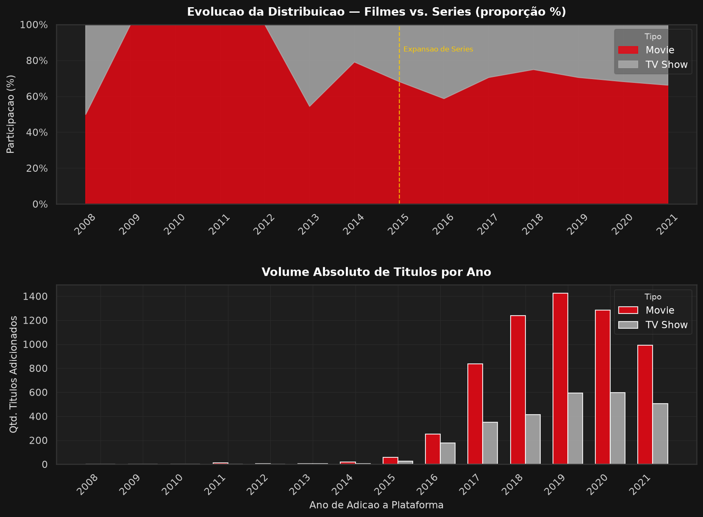
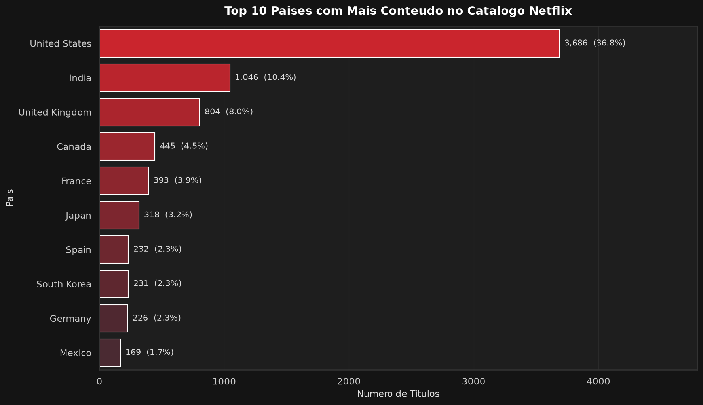
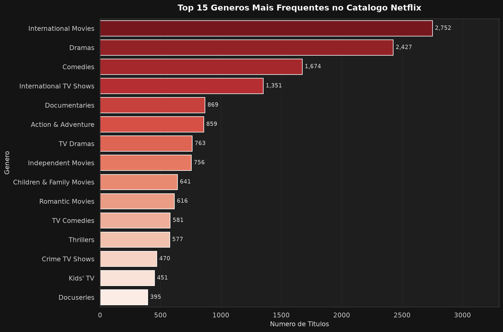
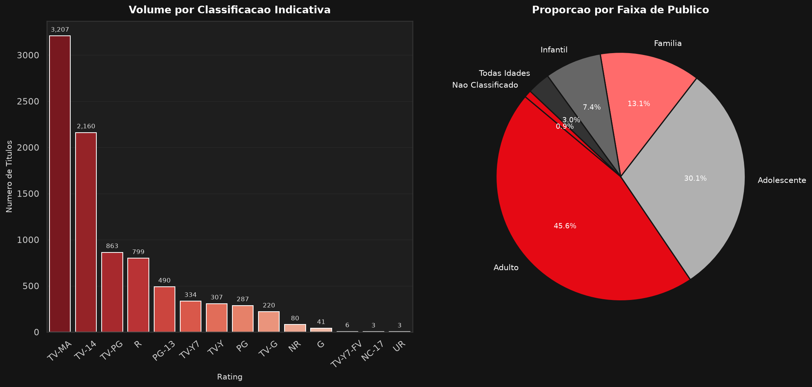
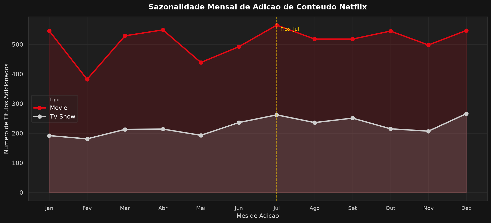
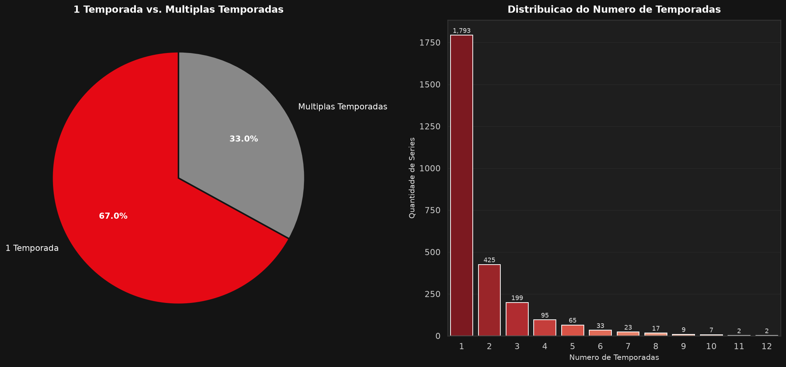

# 📊 Análise Exploratória do Catálogo Netflix

> **Dataset:** `netflix_titles.csv` — 8.804 títulos (filmes e séries)  
> **Período de adição:** 2008 – 2021  
> **Ferramentas:** Python 3 · pandas · numpy · seaborn · matplotlib  
> **Script de análise:** [`analise_netflix.py`](./analise_netflix.py)  
> **Gráficos gerados:** [`graficos/`](./graficos/)

---

## Sumário

1. [Evolução de Filmes vs. Séries](#1-evolução-de-filmes-vs-séries)
2. [Top 10 Países Produtores](#2-top-10-países-produtores)
3. [Gêneros Mais Frequentes](#3-gêneros-mais-frequentes)
4. [Distribuição por Classificação Etária](#4-distribuição-por-classificação-etária)
5. [Sazonalidade Mensal](#5-sazonalidade-mensal)
6. [Séries: 1 Temporada vs. Múltiplas](#6-séries-1-temporada-vs-múltiplas)
7. [Observações Complementares e Próximas Análises](#7-observações-complementares-e-próximas-análises)

---

## 1. Evolução de Filmes vs. Séries

**Pergunta:** Como a distribuição entre filmes e séries evoluiu na plataforma ao longo dos anos?



### Insights

- **Filmes dominam consistentemente** o catálogo Netflix, representando **66,3% do total** em 2021 — uma proporção que se manteve estável ao longo dos anos, com leve compressão em favor das séries entre 2015 e 2018.
- **A partir de 2015**, observa-se uma **aceleração no volume de séries adicionadas**, coincidindo com a expansão internacional da Netflix e os investimentos em conteúdo original (*Netflix Originals*). Essa movimentação reduziu a vantagem relativa dos filmes, mas não reverteu a liderança do formato.
- O **pico de adições absolutas** ocorreu entre **2018 e 2020**, quando a plataforma ampliou agressivamente seu catálogo em mercados emergentes como Índia, Brasil e Coreia do Sul.
- A **queda em 2021** reflete o corte no período de observação do dataset (dados até setembro de 2021), não necessariamente uma retração estratégica.

---

## 2. Top 10 Países Produtores

**Pergunta:** Quais são os 10 países que mais produzem conteúdo no catálogo e qual é a participação de mercado de cada um?



### Insights

- **Estados Unidos lideram com 36,8%** do catálogo, exercendo dominância clara sobre todos os demais países — mais que o dobro do segundo colocado.
- **Índia ocupa o 2º lugar**, refletindo o massivo investimento da Netflix no mercado sul-asiático após sua entrada em 2016. O conteúdo de Bollywood e produções regionais impulsionaram essa posição.
- **Reino Unido, Japão e Coreia do Sul** figuram entre os 5 primeiros, evidenciando o apetite global por conteúdo anglófono de qualidade e pelo fenômeno do *K-Drama*, que explodiu em audiência após 2019.
- **Brasil e México** representam a América Latina no ranking, com crescimento acelerado a partir de 2018 como parte da estratégia de localização da Netflix.
- A presença de **Espanha, França e Canadá** no top 10 demonstra diversificação geográfica, ainda que Europa e América do Norte concentrem a maioria do catálogo.

> **Nota metodológica:** títulos com co-produção entre países (ex: `"USA, Germany"`) são contabilizados individualmente para cada país, o que pode elevar ligeiramente os totais de nações frequentemente parceiras.

---

## 3. Gêneros Mais Frequentes

**Pergunta:** Quais são as combinações de gêneros mais frequentes na plataforma?



### Insights

- **International Movies** lidera com **2.752 títulos**, evidenciando que o catálogo da Netflix é genuinamente global — o conteúdo não-americano já supera qualquer gênero isolado.
- **Dramas e Comédias** ocupam as posições seguintes como categorias transversais clássicas, estando presentes em praticamente todas as combinações de gênero.
- **Documentários** aparecem em destaque, sinalizando o investimento da plataforma em jornalismo investigativo, biografias e narrativas de impacto social — segmento com alta taxa de engajamento e baixo custo relativo de produção.
- **International TV Shows** no top 5 reforça o fenômeno das séries estrangeiras, puxado pelo K-Drama sul-coreano, Anime japonês e produções europeias.
- A presença de **Kids' TV e Children & Family Movies** demonstra a preocupação em fidelizar usuários com perfis familiares, especialmente no segmento de assinantes com filhos.

---

## 4. Distribuição por Classificação Etária

**Pergunta:** Qual é a distribuição das classificações indicativas (rating) do catálogo global?



### Insights

- **TV-MA** (conteúdo para adultos, equivalente a +18) é **a classificação mais comum** do catálogo Netflix, indicando que a plataforma tem foco primário em audiência adulta.
- Somando TV-MA, R e NC-17, o **conteúdo adulto representa 45,6% do catálogo** — quase metade de toda a biblioteca disponível.
- **TV-14** (equivalente a PG-13) é o segundo grupo mais expressivo, apontando para uma forte fatia de entretenimento voltado ao público adolescente e jovem adulto.
- Conteúdo **infantil e família** (TV-Y, TV-Y7, G, PG) compõe uma parcela significativa mas menor, o que contrasta com a percepção de que grandes plataformas equilibram seus catálogos entre todas as faixas etárias.
- O predomínio de conteúdo adulto sugere que a Netflix prioriza assinantes com maior poder aquisitivo e autonomia de escolha — perfil que tende a manter assinaturas por mais tempo.

---

## 5. Sazonalidade Mensal

**Pergunta:** Como variam os meses do ano em que há mais adições de novos conteúdos?



### Insights

- **Julho é o mês de pico** de adições ao catálogo, tanto para filmes quanto para séries — um período estratégico que antecede as férias de verão no hemisfério norte e coincide com janelas de contrato com estúdios.
- **Janeiro** apresenta volume expressivo, típico de plataformas que utilizam o início do ano para renovar o catálogo e reter assinantes que considerariam cancelar após as festas de fim de ano.
- Os **meses de março a maio** revelam um padrão de menor adição, possivelmente relacionado ao ciclo de produção da indústria audiovisual (desenvolvimento de projetos, pré-produção).
- **Filmes e séries seguem padrões sazonais semelhantes**, sugerindo que a estratégia de curadoria e licenciamento não diferencia significativamente o calendário editorial por formato.
- **Setembro e outubro** mostram recuperação, antecipando a temporada de prêmios (*awards season*) — momento em que a Netflix posiciona seus títulos com maior potencial de reconhecimento crítico.

---

## 6. Séries: 1 Temporada vs. Múltiplas

**Pergunta:** Qual é a proporção de séries com apenas 1 temporada em comparação com séries de múltiplas temporadas?



### Insights

- **67,0% das séries no catálogo Netflix possuem apenas 1 temporada** — dado que pode indicar três fenômenos distintos: cancelamentos precoces, minisséries intencionalmente curtas (formato *limited series*) ou conteúdo licenciado de outros países.
- A prevalência de séries curtas é coerente com a estratégia da Netflix de **testar formatos com baixo risco de investimento prolongado**: lança a primeira temporada, avalia métricas de engajamento e decide sobre renovação.
- **Séries com 2 a 3 temporadas** constituem a segunda maior fatia, indicando que quando uma série passa da barreira da primeira temporada, ela tende a ganhar ao menos mais uma.
- Existem **séries com mais de 10 temporadas**, em geral conteúdo licenciado de redes de TV tradicionais (ex: séries de procedimento policial americanas).
- O modelo *limited series* (1 temporada como produto final) tem crescido como formato narrativo próprio, o que pode inflar artificialmente o percentual de séries com 1 temporada.

---

## 7. Observações Complementares e Próximas Análises

As análises acima revelam padrões claros de comportamento estratégico da Netflix. A seguir, propomos desdobramentos analíticos que podem aprofundar o entendimento do catálogo:

### 🔍 Geopolítica do Conteúdo
- **Correlação entre investimento geográfico e crescimento de catálogo:** o crescimento de Índia e Coreia do Sul no ranking coincide com a expansão da Netflix nesses mercados. Seria possível correlacionar dados de adição de conteúdo por país com os anúncios oficiais de investimento da plataforma e dados de crescimento de assinantes por região?

### 📺 Cancelamentos e Longevidade de Séries
- **67% das séries têm apenas 1 temporada.** Uma análise cruzando essa informação com os ratings no IMDb ou Rotten Tomatoes poderia revelar se há correlação entre qualidade percebida e continuidade — ou se fatores puramente financeiros e de engajamento determinam a renovação.

### 🎬 Produção Original vs. Licenciada
- O campo `director` está ausente em muitos registros de TV Shows. Um estudo de completude e padrão de ausência dos dados pode revelar se conteúdo licenciado (com dados menos estruturados) é tratado diferentemente do conteúdo original.

### 🕰️ Produção Histórica vs. Contemporânea
- O dataset contém títulos de 1925 a 2021. Uma análise do `release_year` vs. `year_added` poderia revelar a **idade média do conteúdo** quando entra no catálogo — e se a Netflix está priorizando conteúdo recente ou apostando em catálogos clássicos como diferencial.

### 🌍 Big Tech, Streaming Wars e Catálogo
- A aceleração de adições entre 2018–2020 coincide com o lançamento de concorrentes diretos (Disney+ em 2019, HBO Max em 2020, Apple TV+ em 2019). **Há evidência de que a Netflix intensificou a produção como resposta competitiva?** Um estudo temporal mais granular, cruzado com datas de lançamento dos concorrentes, poderia responder essa hipótese.

### 💡 Análise de Sentimento das Descrições
- O campo `description` (sinopses) oferece material rico para **NLP (Processamento de Linguagem Natural)**. Uma análise de sentimento ou extração de tópicos (LDA) poderia revelar os temas narrativos dominantes e como eles evoluem por ano ou gênero.

---

## Configuração do Ambiente

```bash
# Clonar e criar o ambiente virtual
python3 -m venv venv
source venv/bin/activate

# Instalar dependências
pip install -r requirements.txt

# Executar a análise completa
python analise_netflix.py
```

Os gráficos serão gerados automaticamente na pasta `graficos/`.

---

*Análise realizada com base no dataset público `netflix_titles.csv` — última atualização registrada: setembro de 2021.*
